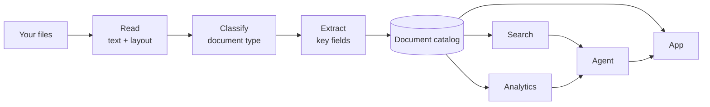

# Document Intelligence App Template

Turn a folder of documents into searchable, structured data in your own Snowflake account, with a ready-made app on top. Clone the repo, open it in Cortex Code, and say **"set up document intelligence"**.

## What it does

Contracts, invoices, reports, and correspondence often sit in files that can't be queried. This template uses Snowflake Cortex AI to read each file, decide what kind of document it is, and pull out key fields such as parties, reference numbers, dates, and amounts. The results land in tables you own, and a web app lets people:

- browse and filter every document by type, line of business, and extracted field
- search by meaning, down to the page
- ask an agent questions and get answers that cite their sources
- review and correct low-confidence results

The pipeline, data, and app are deployed in your own Snowflake account, and people sign in to the app with their Snowflake user. No sample documents ship with the template; you try it on your own.

## How it works

A pipeline processes each upload right away and checks for new files once a day; setup asks how often your documents arrive and sets the schedule to match. Cortex AI reads each file, sorts it into a document type, and extracts fields into a catalog. Cortex Search and a semantic view sit on that catalog, and a Cortex Agent uses both to answer questions. Documents the AI is unsure about go to a Review Queue for a person to check.

## Get started

1. Clone this repo and open the folder in Cortex Code.
2. Type **`set up document intelligence`**.
3. Tell it which Snowflake connection to use and where your documents are.

Cortex Code checks your prerequisites, sets up the account, deploys the pipeline and app, uploads your documents, waits for them to process, and opens the app. You need account admin rights once, for the initial setup; Cortex Code tells you if someone else has to run that step.

**Start with about 20 typical documents.** A small set lets you check the results and tailor the app before you pay to process everything.

## Make it yours

Two more phrases do the rest:

- **`tailor document intelligence to my business`** reads a sample of your processed documents and proposes document types, lines of business, field names, suggested searches, and agent questions. You approve once, and it applies them and reprocesses. Do this while the set is small.
- **`make document intelligence mine`** offers a menu: branding, object and role names, which tabs exist, who sees what, and how the agent behaves.

Most changes need a redeploy, which rebuilds the app but keeps your documents and data. Group changes and redeploy once.

## Load the rest

When the app fits your documents, ask Cortex Code to load the rest, or upload from the app's Pipeline Management tab. Large loads run back to back in batches of 100 documents until everything is processed.

Cost follows **pages, not documents**: Snowflake bills document parsing per page (see [Parsing documents with AI_PARSE_DOCUMENT](https://docs.snowflake.com/en/user-guide/snowflake-cortex/parse-document)). Reprocessing after a change runs the AI steps again on every document, which is why you tailor first.

## Who sees what

Snowflake roles decide who can open the app. Inside the app, app roles decide which tabs, document types, and lines of business each person sees, and whether they can download originals.

> **Important:** app roles filter the app's document views only. Anyone with the app's user role can see every document through SQL, and the agent answers from every document regardless of app role. Grant access only to people who may see all documents.

## Learn more

- [User Manual](docs/USER_MANUAL.md): using each tab
- [Operations Guide](docs/OPERATIONS_GUIDE.md): prerequisites, manual setup, customization by hand, cost tracking, and troubleshooting
- [Data Dictionary](docs/DATA_DICTIONARY.md): tables, views, and fields
- [API Reference](docs/API_REFERENCE.md): the app's API

If something goes wrong, describe it in Cortex Code and it will walk you through the fix.
